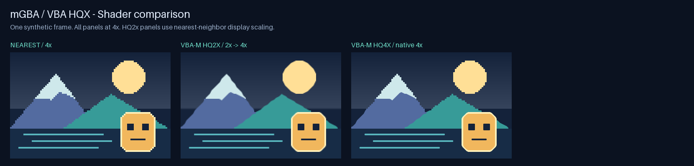

# VBA-M HQX shaders for mGBA

Original VBA-M portable 32-bit **HQ2X** and **HQ4X**, ported to mGBA shaders.



| Folder | GBA output | Filter |
| --- | --- | --- |
| `hq2x.shader` | 480 × 320 | Original HQ2x |
| `hq4x.shader` | 960 × 640 | Original HQ4x |

## Install

Download the shader ZIP from [Releases](https://github.com/krupar101/mgba-hqx-shaders/releases).
It contains only these two `.shader` folders. Extract it, keep each folder intact,
and load the desired folder in mGBA's shader settings. Each includes its manifest,
fragment shader, README and GPL license. Source checkouts keep them in `shaders/`.

Use mGBA's modern desktop OpenGL renderer. Compare at integer display sizes with
bilinear filtering disabled. HQ2x enlarged to 4× retains its 2× filtering grid;
HQ4x computes a true 4× grid. Neither guarantees identical screenshots to old VBA
Windows builds. See [compatibility](docs/COMPATIBILITY.md).

## Build and validate

Requires Python 3.10+, a C++11 compiler, Make and Mesa EGL/OpenGL libraries.

```bash
make verify        # reproducible generation and pixel-exact C reference tests
make package-test  # ZIP contents and checksum validation
make preview       # regenerate comparison; additionally requires Pillow
```

The headless suite covers 512 frames per shader and native GBA-size borders and
orientation. The preview uses original synthetic artwork rendered by the shaders.
See [implementation](docs/IMPLEMENTATION.md), [validation](docs/VALIDATION.md),
and [contribution guidelines](CONTRIBUTING.md).

## License

GPL-2.0-or-later. HQX originated with Maxim Stepin; these ports use the pinned
VBA-M source snapshot and preserve its notices. See [LICENSE](LICENSE),
[NOTICE.md](NOTICE.md) and `vendor/vbam/provenance.json`.
This is an independent project, not an official mGBA or VBA-M release.
